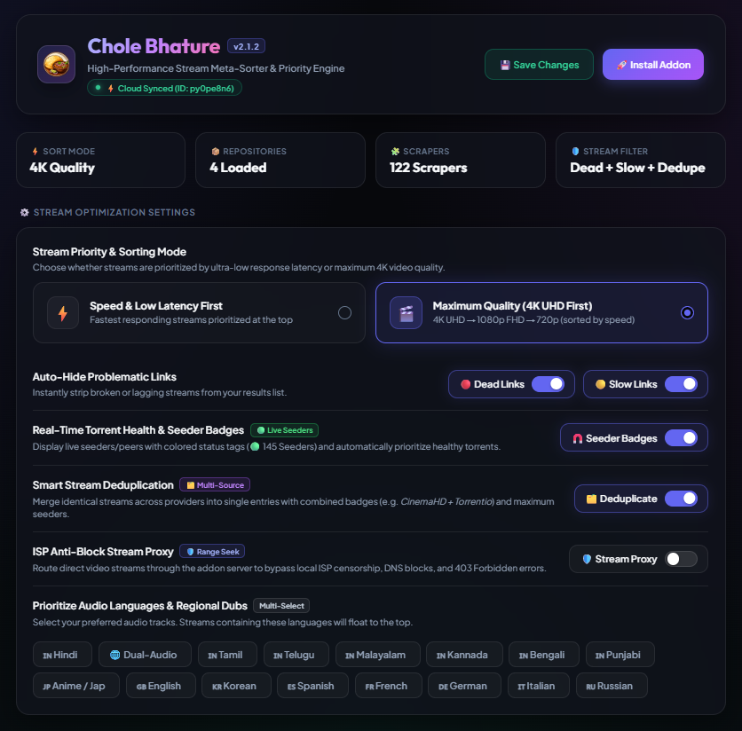

<div align="center">

  

  # Chole Bhature
  ### High-Performance Stream Meta-Sorter & Discovery Hub for Nuvio & Stremio

  [](https://github.com/SA7ANI/chole-bhature)
  [](https://github.com/SA7ANI/chole-bhature)
  [](CHANGELOG.md)
  [](LICENSE)
  [](https://github.com/SA7ANI)
  [](https://t.me/cholebhature_chat)

  <br><br>

  

</div>

---

## 🌟 Overview

**Chole Bhature** is an enterprise-grade stream meta-sorter, provider priority engine, and IPTV discovery hub designed for **Nuvio** and **Stremio**. 

Instead of waiting through buffering wheels or clicking dead links, Chole Bhature intercepts stream requests from **120+ scrapers across multiple provider repositories**, concurrently **live-probes every stream for latency and health**, eliminates duplicate mirrors with **Smart Mirror Stacking**, resolves Debrid torrents and HubCloud direct links, and serves a cleanly organized, deterministic stream list tailored to your exact audio, quality, and speed preferences.

With persistent **Upstash Redis KV caching**, **Self-Healing Stream Failover**, and **Adaptive Fast-Edge DNS routing**, warm queries return in under **350ms** across all your linked devices.

---

## ✨ Key Features

| Feature | Description |
| :--- | :--- |
| 🧲 **P2P Un-Cached Magnet Block / Filter** | Toggle un-cached P2P torrent magnets off completely with `hideP2P`, showing exclusively cached Debrid (`[RD+]`, `[TB+]`) and direct HTTP/HLS streams. |
| ⚡ **Smart Mirror Stacking & Deduplication** | Normalizes release signatures and collapses identical releases from dozens of scrapers into a single primary stream card backed by the fastest live route, cutting stream list clutter by up to 70%. |
| 🛡️ **Self-Healing Stream Failover Proxy** | High-resilience streaming proxy that automatically detects dead links or HTTP 403/404 errors during playback and transparently fails over to secondary mirrors without interrupting playback. |
| ⚡ **Sub-3s Real-Time Latency Probing** | Concurrently tests HTTP/HLS streams via lightweight `Range`/`HEAD` probes. Employs **Domain Health Coalescing** to avoid socket congestion and accurately tags links with `🟢 FAST (<800ms)`, `🟡 SLOW (≥800ms)`, or `🔴 DEAD` without premature bailouts. |
| ☁️ **Persistent Upstash Redis KV Caching** | Multi-device cloud cache sync powered by `@vercel/kv`. Cold scrapes are cached globally so secondary devices (Smart TVs, Android boxes, desktops) resolve stream lists in **~300ms**. |
| 🔄 **Smart Cache Invalidation & Force Refresh** | Deep cache purge via UI or `/refresh.json` stream routes that scans and deletes both in-memory entries and wild-matched Redis keys (`cb:str:*<id>*`) to pull freshly indexed releases on demand. |
| 🛡️ **Adaptive DoH & Fast-Edge CDN Routing** | Multi-provider DNS-over-HTTPS (Cloudflare, Google, AdGuard, Quad9) with **Native DNS Fast-Bypass** for GitHub, jsDelivr, Codeberg, and TMDB, bypassing ISP DNS throttling and route hang-ups. |
| 🧩 **Sandboxed Provider Engine & Globals** | Custom isolated VM environment executing 120+ community scrapers with comprehensive browser/Node runtime emulations (`SCRAPER_SETTINGS`, `globalThis`, `fetch`, `crypto`, `Buffer`). |
| ⚡ **Instant HubCloud Direct Resolvers** | Built-in extractor for HubCloud and hoster redirects, resolving direct CDN video streams on the fly without third-party popups or redirects. |
| ⚡ **Telegram Cloud Streaming** | Stream movies & TV episodes directly from Telegram channels via **PencariMovie** index without requiring Real-Debrid or torrent seeders. Supports HTTP `Range` requests and automatic web player fallback. |
| 💎 **Debrid Premium Resolvers** | Add your Real-Debrid, AllDebrid, or Torbox API key to unrestrict cached torrents. Replaces magnets with high-speed direct CDN links tagged with `⚡ [RD+]`, `⚡ [AD+]`, or `⚡ [TB+]`. |
| 📡 **Live TV & IPTV Playlist Studio** | Pro-grade IPTV player with 1-click curated public broadcasts, interactive Channel Explorer, live stream latency tester, custom M3U/M3U8 URLs, and Xtream Codes login. |
| 📺 **Curated Discovery Feeds** | Native catalog feeds for **Popular Right Now**, **Trending Indian Cinema**, **Anime**, and **Live TV** (`News`, `Sports`, `Movies`, `Music`, `India`, `USA`, etc.) with sub-category filters in Stremio & Nuvio. |
| 🛑 **Scraper Quarantine System** | Automatically isolates failing or unresponsive scrapers for 10 minutes after consecutive errors, eliminating scrape timeout penalties. |
| 🎛️ **Granular Source Management** | Enable or disable individual scrapers or bulk-toggle entire provider repositories with a single click in the Sources tab. |
| 🎬 **Strict 4K UHD Hierarchy** | Strict resolution-first ordering (`4K UHD` > `1080p FHD` > `720p HD` > `480p SD`). Lower quality releases never leapfrog 4K streams in Quality mode. |
| 🚫 **Auto-Hide CAM & Theater Rips** | Automatically identifies and filters out blurry recordings (`CAM`, `HDCAM`, `TeleSync`, `TC`, and `Screeners`). |
| 🧲 **Smart P2P Swarm Health** | Accurately maps torrent swarm seeders to health badges (`🟢 20+ Healthy`, `🟡 5–19 Moderate`, `🔴 1–4 Buffering Risk`) to prevent stalled playback. |
| 🌐 **Regional & Multi-Audio Priority** | Float your preferred audio languages (`Hindi`, `Tamil`, `Telugu`, `Malayalam`, `Dual-Audio`, `English`, `Anime/Jap`, etc.) directly to the top of your stream list. |
| 📊 **Real-Time Telemetry & Diagnostics** | Diagnostic dashboard with live RAM RSS gauges, cache hit ratios, and scraper health stats. |

---

## 🚀 Getting Started

### 💻 Running Locally or on a Server / VPS

```bash
# 1. Clone the repository
git clone https://github.com/SA7ANI/chole-bhature.git
cd chole-bhature

# 2. Install dependencies
npm install

# 3. (Optional) Configure Upstash Redis KV in .env
KV_REST_API_URL="https://your-upstash-instance.upstash.io"
KV_REST_API_TOKEN="your-upstash-token"

# 4. Start the server
npm start
```

Visit [http://localhost:7000/configure](http://localhost:7000/configure) in your browser.

---

## 🎛️ Intelligent Sorting Modes

Choose your preferred ranking algorithm in the dashboard:

1. **⚡ Speed & Low Latency First (Default)**: Ranks streams strictly by verified millisecond response time, delivering the fastest playing links at the very top.
2. **🎬 Maximum Quality (4K UHD First)**: Enforces strict resolution tiers (`4K UHD` > `1080p FHD` > `720p HD`), sorted by ping speed and release quality (`REMUX` > `BluRay` > `WEB-DL`) within each tier.
3. **⚖️ Smart Balanced**: High-efficiency matrix prioritizing `4K Fast` > `1080p Fast` > `4K Slow` > `1080p Slow` > `720p Fast`.
4. **🧲 P2P Seeders First**: Organizes torrent streams by highest verified active seeders and swarm health.

---

## ⚡ High-Speed Architecture & Optimizations

```
   Stremio / Nuvio Client Request
                 │
                 ▼
      [ Stale-While-Revalidate ]
                 │
      ┌──────────┴──────────┐
  Cache Hit             Cache Miss
      │                     │
[ ~350ms Response ]   [ Concurrently Query Scrapers ]
                      (Adaptive DoH & Native Bypass)
                            │
                            ▼
               [ Domain Probe Coalescing ]
               (Live Latency Ping in <3.0s)
                            │
                            ▼
               [ Multi-Audio & Tier Sorting ]
                            │
                            ▼
               [ Upstash Redis KV Storage ]
                            │
                            ▼
                   [ Stream Delivery ]
```

### 1. Domain Health Coalescing
Instead of flooding hosting providers with 100+ separate TCP/TLS handshakes, the testing engine detects shared domain clusters (e.g. multi-part links hosted on the same mirror). It pings the edge endpoint once and propagates the live latency to associated streams, completing full catalog verification in **under 3 seconds**.

### 2. Adaptive DNS-over-HTTPS (DoH)
Indian and international ISPs often inject packet loss or DNS-poison GitHub and content mirrors. Chole Bhature utilizes DoH with automated bypass rules: requests to GitHub, jsDelivr, Codeberg, and TMDB use fast native routes while scrapers use secure encrypted DoH, preventing 100s+ timeout hangs.

### 3. Distributed Redis KV Cache
When running on serverless (Vercel, Render, Railway) or multi-instance VPS, stream caches persist across restarts and are synced across all your household devices.

---

## 📡 Live TV & IPTV Playlist Studio

Chole Bhature includes a complete IPTV subsystem:
* **Curated 24/7 Channels**: Free legal news, sports, music, and regional broadcasts from around the world.
* **Custom M3U/M3U8 URLs**: Paste your own playlist link; Chole Bhature parses TVG metadata and categorizes channels automatically.
* **Xtream Codes API**: Enter your server URL, username, and password to load live channels directly into Stremio/Nuvio.
* **Stream Prober**: Test any live channel's latency, status, and content type before playback.

---

## ⚡ Telegram Cloud Streaming

Chole Bhature includes native integration with Telegram cloud-hosted media indexing powered by **[PencariMovie Server](https://github.com/aiskendi/pencarimovie-server)**:
* **100% Free & Debrid-Free**: Access direct cloud streams for thousands of movies and TV series without needing Real-Debrid, AllDebrid, or P2P torrent swarms.
* **Intelligent Series & Episode Filtering**: Automatically identifies season and episode markers, filtering files precisely for requested episodes (e.g. `Loki S01E01`).
* **Multi-Part Video Grouping**: Automatically recognizes split releases and tags them cleanly as `[Part 1/2]`, `[Part 2/2]`, etc.
* **High-Speed MTProto Bridge**: Connects with a local or remote MTProto streaming bridge daemon (`http://127.0.0.1:8088`), proxying `HTTP 206 Partial Content` byte ranges for seamless player scrubbing and fast seeking.
* **Graceful Web Fallback**: If no local bridge daemon is running, links gracefully redirect via `HTTP 302` to PencariMovie's public web player so streams never fail.

---

## 🛠️ Diagnostics & Admin Dashboard

Under the **Diagnostics & Admin** tab, you can monitor and manage your deployment:
* **Real-Time Memory & Headroom**: Track active RSS usage, heap memory, and buffer headroom.
* **Telemetry Profiler**: Live request latency tracking, cache hit/miss analytics, and scraper health metrics.
* **Scraper Quarantine Inspector**: View temporarily isolated or failing providers with countdown timers.
* **Instant Cache Purge**: Single-button flush for local memory and distributed Redis keys.
* **Granular Overrides**: Set custom scraper domain mirrors and request headers directly from the web interface.

---

## 🛠️ Tech Stack & Architecture

* **Runtime:** Node.js (v18+)
* **Server Framework:** Express.js (High-performance HTTP API & Stremio Addon Router)
* **SDK:** Stremio Addon SDK (`stremio-addon-sdk`)
* **Persistent Cache:** Upstash Redis KV (`@vercel/kv`) & In-Memory LRU
* **Scraper Engine:** Axios, Cheerio, Crypto-JS, Node-Fetch, Node:vm isolation
* **DNS Resolver:** Adaptive DNS-over-HTTPS (DoH) with Fast-Edge Native DNS bypass
* **Frontend:** Vanilla HTML5, Modern CSS3 Glassmorphism, Offline PWA Service Worker

---

## 💬 Join the Community

Connect with other users, get support, report bugs, request new features, and stay updated on the latest Chole Bhature developments by joining our official Telegram group!

👉 **[Join the Chole Bhature Telegram Chat](https://t.me/cholebhature_chat)**

---

## 🙏 Credits & Acknowledgments

* **[PencariMovie Server](https://github.com/aiskendi/pencarimovie-server)** by **[@aiskendi](https://github.com/aiskendi)**: Telegram cloud streaming architecture & media indexer.
* **Nuvio & Stremio Community**: For the open-source media player ecosystems and community addon protocols.
* **Eclipsia, Yoruix & D3adlyRocket**: For community provider definitions and scraper repositories.

---

## ⚖️ Attribution & Anti-Leech Policy

This project is free and open-source under the **GNU Affero General Public License v3.0 (AGPL-3.0)**.

If you fork, self-host, or redistribute any portion of this software (including modified versions running over a network or container service):
1. **Mandatory Credit**: You **MUST** retain visible attribution to the original author (**SA7ANI**) and link back to the official repository: [`https://github.com/SA7ANI/chole-bhature`](https://github.com/SA7ANI/chole-bhature).
2. **No De-Branding**: Stripping author credits, repository links, or branding from the UI, API responses, terminal logs, or manifest without explicit permission is a direct violation of the GNU AGPLv3 license terms.
3. **Open Source Requirement**: Any network-accessible deployment running modified code must provide the full corresponding source code under the same AGPL-3.0 license.

---

## 📝 License & Copyright

Copyright (C) 2026 **SA7ANI** (<https://github.com/SA7ANI/chole-bhature>)

Licensed under the **GNU Affero General Public License v3.0 (AGPL-3.0)**. See the [LICENSE](LICENSE) and [NOTICE](NOTICE) files for full legal terms.

